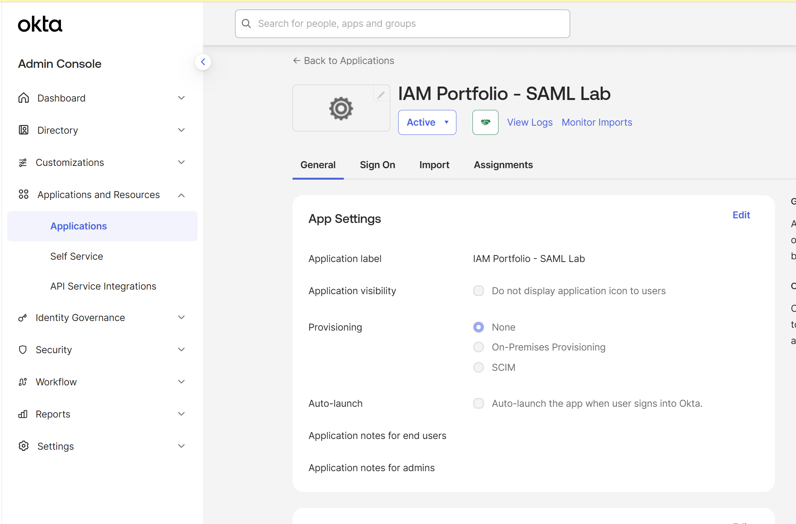
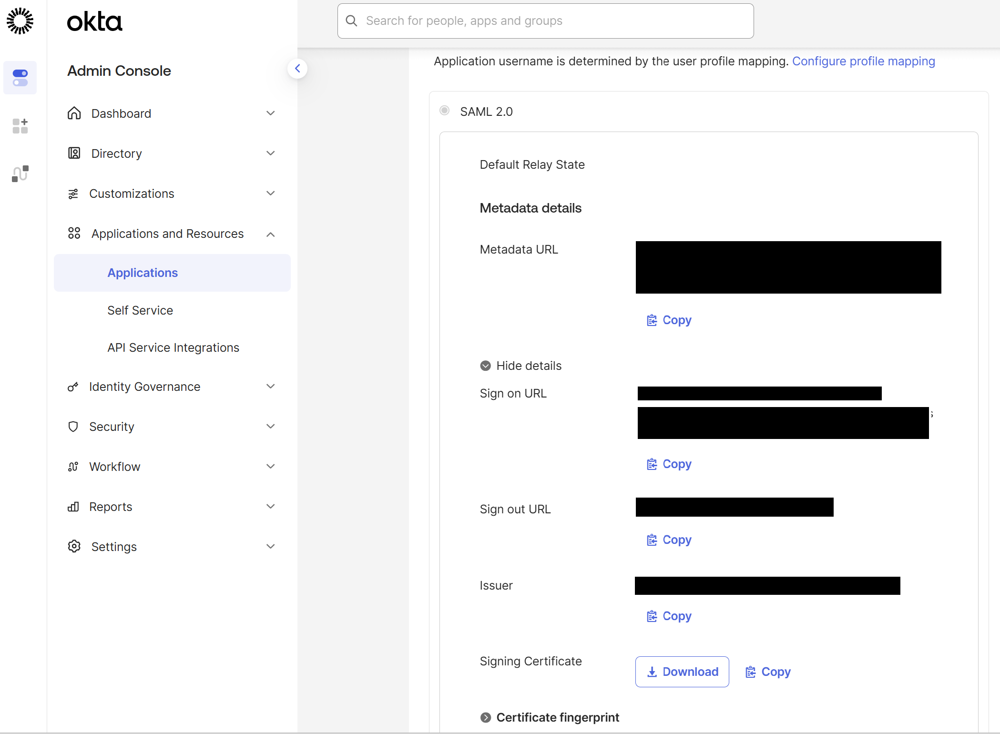
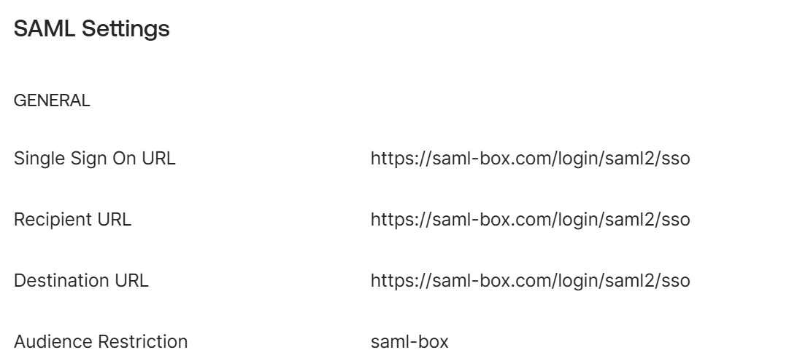
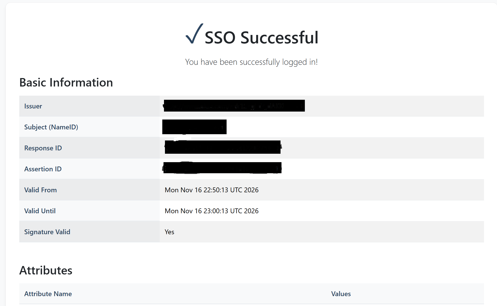
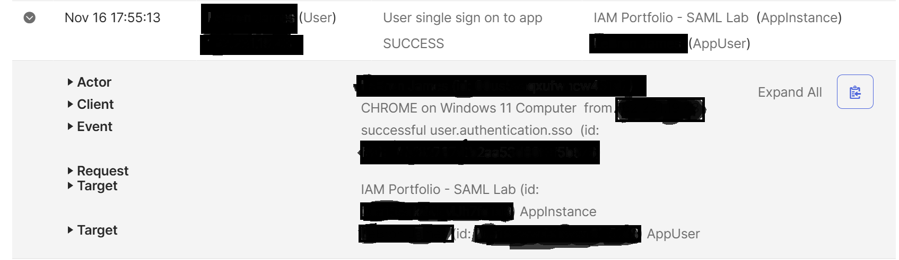
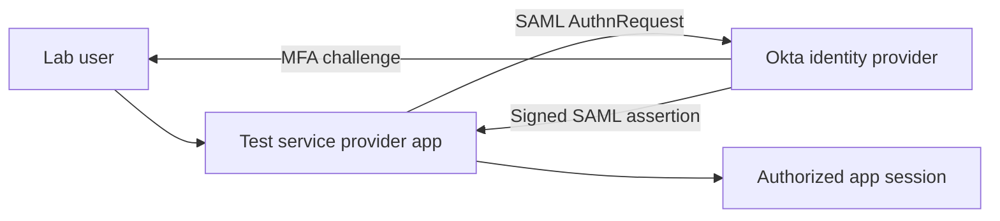

# Okta SAML SSO Integration — IAM Engineering Portfolio

> **Status:** Lab in progress. This repository does **not** contain employer systems, screenshots from personal lab, or confidential configuration. The author has production experience integrating approximately 25+ Okta applications, primarily using SAML. The lab described below must be completed and verified before being presented as finished work.

## Problem statement
Centralize application authentication with Okta, enforce MFA, and reduce reliance on application-specific passwords.
## Phase 1: Okta Application Integration

**Objective:** Create and configure an Okta application integration in a personal development environment as the foundation for a SAML 2.0 SSO implementation.

### Configuration Completed

- Created an application named `IAM Portfolio - SAML Lab`.
- Selected SAML 2.0 as the authentication protocol.
- Configured the service provider's ACS URL and Entity ID using its published metadata.
- Confirmed the application status is Active.
- Reviewed application settings and confirmed provisioning is set to None, because this project focuses on SAML authentication rather than SCIM provisioning.

### Evidence

**Application Overview**

**Okta Identity Provider Metadata**

### Phase 2: Okta IdP Metadata Exchange

**Objective:** Establish the SAML metadata exchange between Okta (Identity Provider) and SAML BOX (Service Provider).

**Implementation:**
- Downloaded the SAML Identity Provider metadata XML from the Okta application.
- Uploaded the Okta IdP metadata XML to SAML BOX.
- Confirmed that SAML BOX received the metadata and displayed the Okta issuer (Entity ID).
- Sanitized the evidence screenshot to protect tenant-specific information.

**Validation status:** Metadata upload confirmed. SAML trust configuration and end-to-end authentication have not yet been verified.

**Evidence:** 

### Phase 3: SAML Trust Configuration Verification

**Objective:** Validate the SAML Service Provider configuration between Okta and SAML BOX before authentication testing.

**Configuration Review:**
- Verified that the Okta Audience URI (`saml-box`) matches the SAML BOX SP Entity ID.
- Confirmed that the Single Sign-On URL matches the ACS endpoint published in SAML BOX SP metadata.
- Reviewed the Recipient URL and Destination URL configurations.
- Confirmed that both SAML Response and Assertion Signature settings are configured as Signed.
- Verified that the Okta signing certificate is Active, with an expiration year of 2036.

**Validation Status:** SP Entity ID and ACS URL match the published SP metadata. Signing settings and certificate status were reviewed. Certificate trust and end-to-end SSO authentication remain unverified.

**Evidence — Screenshot #4:**

### Phase 4: SAML Signing Certificate Verification

**Objective:** Verify certificate consistency between the active Okta signing certificate and the certificate published in Okta IdP metadata.

**Implementation:**
- Downloaded the active X.509 signing certificate from Okta.
- Extracted the embedded X.509 certificate from the Okta IdP metadata XML.
- Used Windows CertUtil to inspect both certificates.
- Compared their SHA-1 certificate fingerprints.

**Validation Result:** PASS — Both certificate fingerprints matched, confirming that the metadata contains the same certificate as the active Okta signing certificate.

**Security Considerations:**
- Performed certificate comparison locally.
- Did not publish raw metadata or certificate files to GitHub.
- Certificate consistency was verified; SAML BOX signature validation and end-to-end authentication remain untested.

### Phase 5: Non-Admin Test User Assignment

**Objective:** Provision application access for a non-administrative Okta test user while following least-privilege principles.

**Implementation:**
- Identified an existing non-admin test user in the Okta tenant.
- Verified that the user's account status was Active.
- Assigned the user directly to the IAM Portfolio - SAML Lab application.
- Reviewed the application username during assignment.
- Confirmed that the user appeared in the application's Assignments tab.

**Validation Result:** PASS — The non-admin test user was successfully assigned to the SAML application.

**Security Considerations:**
- Used a non-administrative account for application access testing.
- Limited provisioning to the intended SAML application.
- Redacted the user's identifying information from the public screenshot.
- End-to-end SAML authentication has not yet been tested.

**Evidence — Screenshot #5:**

### Phase 6: SAML SSO Authentication Testing

**Objective:** Validate end-to-end SAML 2.0 Single Sign-On using Okta as the Identity Provider (IdP) and SAML BOX as the Service Provider (SP).

**Authentication Method:** Identity Provider-Initiated (IdP-Initiated) SSO

**Implementation:**
- Opened a separate Chrome Incognito session to isolate the test user from the administrator session.
- Authenticated to Okta using an active, non-administrative test account.
- Confirmed the IAM Portfolio - SAML Lab application was visible on the user's Okta dashboard.
- Launched the SAML application from the Okta dashboard.
- Verified redirection to SAML BOX.
- Confirmed that SAML BOX displayed "SSO Successful."

**SAML Security Validation:**
- Confirmed the SAML BOX success page reported "Signature Valid: Yes."
- Observed a 10-minute assertion validity window.
- Previously verified that the active Okta signing certificate matched the certificate embedded in the IdP metadata.
- Used a non-administrative account to validate application access.

**Test Results:**

| Validation Test | Result |
|---|---|
| Non-admin Okta authentication | PASS |
| SAML application assignment | PASS |
| IdP-initiated application launch | PASS |
| SAML BOX authentication | PASS |
| SAML signature validation | PASS |
| Assertion validity window displayed | PASS |

**Overall Result:** PASS

The IdP-initiated SAML SSO authentication test completed successfully. SAML BOX accepted the authentication flow and reported a valid digital signature.

**Evidence — Screenshot #6:**

**Security Note:** The publicly shared screenshot was cropped to exclude user identifiers, SAML response IDs, assertion IDs, and other potentially sensitive authentication data.

### Phase 7: Okta System Log Validation

**Objective:** Validate successful SAML SSO authentication using Okta System Logs and correlate authentication activity with the configured SAML application.

**Tools Used:**
- Okta Admin Console
- Okta System Log
- SAML 2.0
- Chrome Browser

**Implementation:**
1. Accessed the Okta Admin Console using an administrator account.
2. Navigated to Reports > System Log.
3. Filtered authentication events using `user.authentication.sso`.
4. Located the SSO event associated with the non-admin test user.
5. Expanded the event details to examine the authentication outcome.
6. Confirmed that the event referenced the IAM Portfolio - SAML Lab application.

**Authentication Event Analysis:**

| Field | Observed Result |
|---|---|
| Event Type | user.authentication.sso |
| Event Description | User single sign on to app |
| Outcome | SUCCESS |
| Target Application | IAM Portfolio - SAML Lab |
| Client | Chrome on Windows 11 |
| Authentication Method | IdP-Initiated SAML SSO |

**Validation Result:** PASS

The Okta System Log recorded a successful SSO event associated with the IAM Portfolio - SAML Lab application.

This provided identity-provider-side audit evidence supporting the successful SAML authentication previously observed in SAML BOX.

**Security Considerations:**
- Used a non-administrative account for authentication testing.
- Reviewed authentication events using administrator-level audit access.
- Verified the application associated with the successful event.
- Redacted usernames, IP addresses, and unique identifiers from the public evidence.

**Evidence — Screenshot #7:**

**Skills Demonstrated:**
- Okta System Log analysis
- SAML SSO troubleshooting
- Authentication event correlation
- Identity security monitoring
- Audit log validation
- Security-conscious technical documentation

## Lab architecture

## Intended technology
- Okta test/developer tenant (subject to availability and plan limits)
- SAML 2.0-compatible **test** service provider
- Test users and groups, MFA policy
- Browser developer tools and Okta System Log

## Build steps
1. Create isolated test users and groups. Do not use real employee accounts.
2. Select a SAML-capable test service provider and document its ACS URL, entity ID, and name ID requirements.
3. Configure a SAML application integration in Okta and exchange IdP metadata with the test SP.
4. Configure group assignment and MFA policy for the test users.
5. Validate SP-initiated sign-in, then IdP-initiated sign-in if supported.
6. Confirm attributes and NameID format; inspect logs for failed sign-ins.
7. Test negative cases: unassigned user, incorrect audience/ACS, and denied MFA.
8. Document troubleshooting, remediation, and final verification.

## Test matrix
| Test | Expected result | Actual result |
| --- | --- | --- |
| Assigned user with valid MFA | Successful sign-in | Successful |
| Unassigned user | Access denied | Not yet tested |
| Wrong audience or ACS URL | SAML validation failure | Not yet tested |
| MFA denied | No session established | Not yet tested |

## Evidence to add after completing lab
- `diagrams/architecture.png` — your original sanitized architecture diagram
- `screenshots/app-settings-redacted.png` — sanitized SAML configuration
- `screenshots/sign-in-test-redacted.png` — sanitized success/failure test evidence
- `troubleshooting.md` — observed errors, root causes, and resolutions

## Design decisions and lessons learned
*Complete after hands-on testing.* Explain why you selected SAML, how group assignment controls access, how MFA is enforced, and what happens when assertions fail.

## Security and confidentiality
No production metadata, internal URLs, user identifiers, access tokens, certificates/private keys, or real business data are included. Use only synthetic test data and redact tenant identifiers when appropriate.

## Next projects
- SCIM provisioning lab
- Okta Workflows joiner/mover/leaver automation
- Microsoft Entra enterprise application and Conditional Access lab
