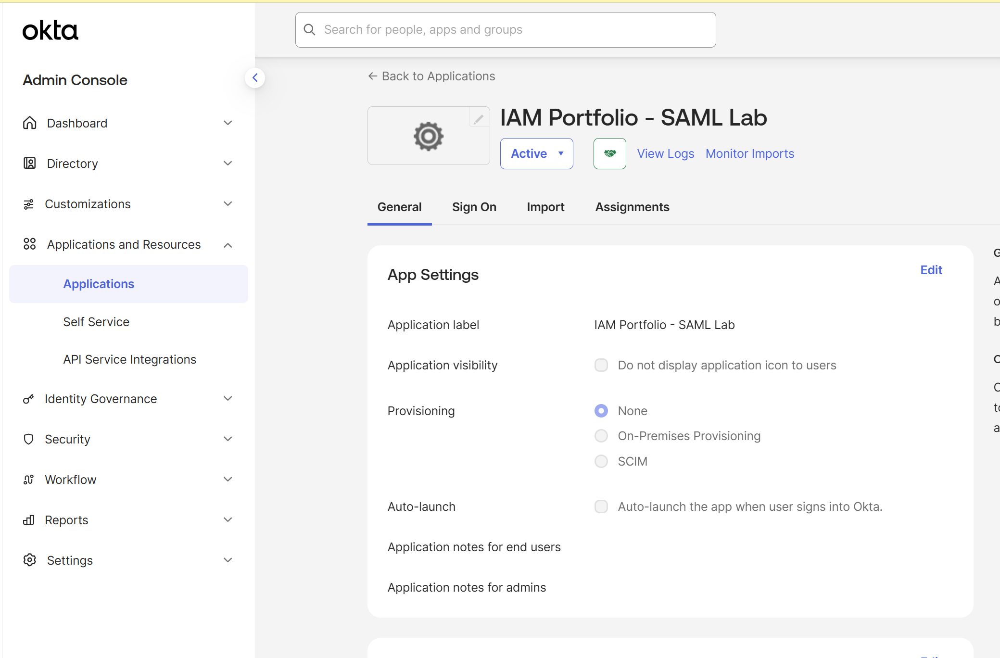
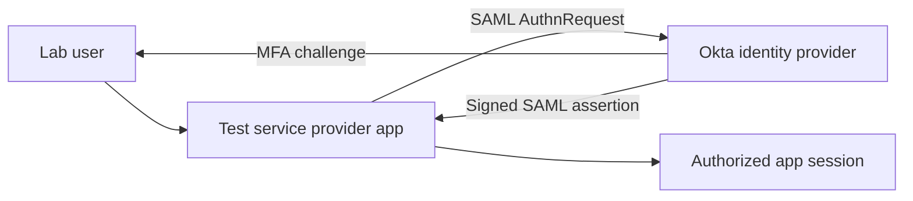

# Okta SAML SSO Integration — IAM Engineering Portfolio

> **Status:** Lab in progress. This repository does **not** contain employer systems, screenshots from personal lab, or confidential configuration. The author has production experience integrating approximately 20 Okta applications, primarily using SAML. The lab described below must be completed and verified before being presented as finished work.

## Problem statement
Centralize application authentication with Okta, enforce MFA, and reduce reliance on application-specific passwords.
## Phase 1: Okta Application Integration

**Objective:** Create and configure an Okta application integration in a personal development environment as the foundation for a SAML 2.0 SSO implementation.

### Configuration Completed

- Created an application named `IAM Portfolio - SAML Lab`.
- Selected SAML 2.0 as the authentication protocol.
- Configured the service provider's ACS URL and Entity ID using its published metadata.
- Confirmed the application status is Active.
- Reviewed application settings and confirmed provisioning is set to None, because this project focuses on SAML authentication rather than SCIM provisioning.

### Evidence

**Application Overview**

**SAML Configuration:** Pending

### Current Status

The Okta application has been created and activated. End-to-end SAML authentication testing is still pending.
## Lab architecture

## Intended technology
- Okta test/developer tenant (subject to availability and plan limits)
- SAML 2.0-compatible **test** service provider
- Test users and groups, MFA policy
- Browser developer tools and Okta System Log

## Build steps
1. Create isolated test users and groups. Do not use real employee accounts.
2. Select a SAML-capable test service provider and document its ACS URL, entity ID, and name ID requirements.
3. Configure a SAML application integration in Okta and exchange IdP metadata with the test SP.
4. Configure group assignment and MFA policy for the test users.
5. Validate SP-initiated sign-in, then IdP-initiated sign-in if supported.
6. Confirm attributes and NameID format; inspect logs for failed sign-ins.
7. Test negative cases: unassigned user, incorrect audience/ACS, and denied MFA.
8. Document troubleshooting, remediation, and final verification.

## Test matrix
| Test | Expected result | Actual result |
| --- | --- | --- |
| Assigned user with valid MFA | Successful sign-in | Not yet tested |
| Unassigned user | Access denied | Not yet tested |
| Wrong audience or ACS URL | SAML validation failure | Not yet tested |
| MFA denied | No session established | Not yet tested |

## Evidence to add after completing lab
- `diagrams/architecture.png` — your original sanitized architecture diagram
- `screenshots/app-settings-redacted.png` — sanitized SAML configuration
- `screenshots/sign-in-test-redacted.png` — sanitized success/failure test evidence
- `troubleshooting.md` — observed errors, root causes, and resolutions

## Design decisions and lessons learned
*Complete after hands-on testing.* Explain why you selected SAML, how group assignment controls access, how MFA is enforced, and what happens when assertions fail.

## Security and confidentiality
No production metadata, internal URLs, user identifiers, access tokens, certificates/private keys, or real business data are included. Use only synthetic test data and redact tenant identifiers when appropriate.

## Next projects
- SCIM provisioning lab
- Okta Workflows joiner/mover/leaver automation
- Microsoft Entra enterprise application and Conditional Access lab
